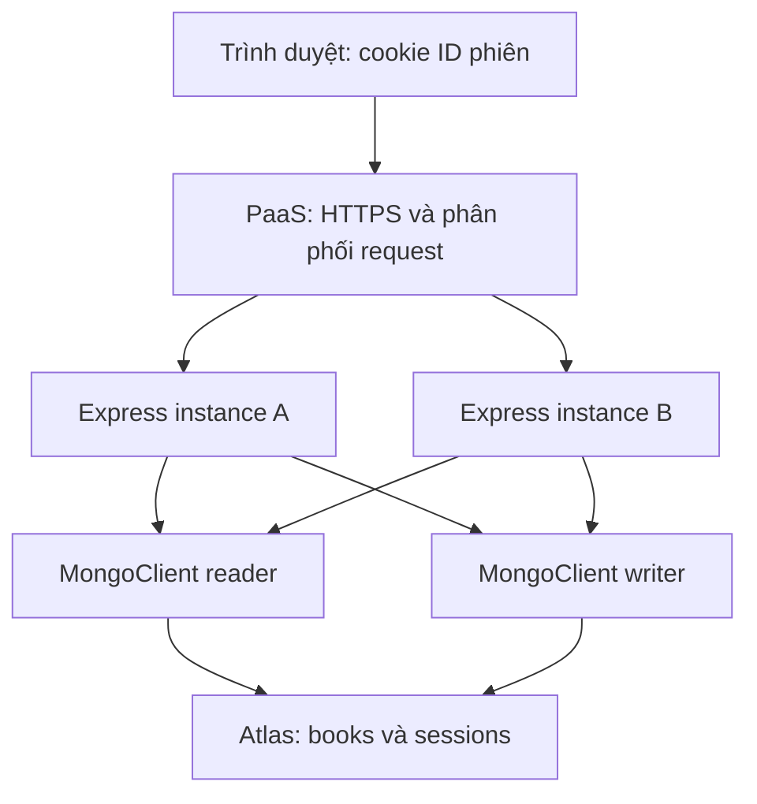

# Bài giữa kỳ Cloud Computing: Quản lý sách

Ứng dụng mẫu theo đề: Node.js/Express, Handlebars, MongoDB Atlas, hai tài khoản database tách biệt, session tập trung và hai nhánh tính năng có merge commit. Bạn cần điền họ tên/MSSV thật, tạo Atlas, đẩy GitHub và deploy bằng tài khoản của mình. Chưa có kết nối Atlas hay website được triển khai sẵn.

## 1. Thiết kế đáp ứng đề



Hai tài khoản DB dùng để phân quyền thao tác dữ liệu, không phải tài khoản đăng nhập người dùng. Đề chưa yêu cầu đăng nhập. Giao diện mẫu cho phép người truy cập xem/thêm sách. Mỗi instance thực tế có hai connection pool riêng; sơ đồ gom chúng theo vai trò cho dễ đọc. Khởi tạo kết nối một lần khi boot, không tạo mới cho từng request.

| Nội dung | Cách thực hiện | File chính |
| --- | --- | --- |
| Database theo MSSV | Tự chọn tên `DB_${MSSV}` | `src/config.js` |
| Đọc/ghi độc lập | GET dùng reader; thêm sách dùng writer.insertOne | `src/database.js` |
| Session tập trung | Store đọc qua reader và ghi qua writer, cùng collection Atlas | `src/atlas-session-store.js` |
| Tiền tố và VAT | Kiểm tra ở backend; VAT lấy chữ số cuối + 4 | `src/book.js` |
| Footer | Họ tên, MSSV, VAT | `views/layouts/main.hbs` |
| DevOps | .gitignore, hai nhánh, hai merge commit, CI | `.git/`, `.github/workflows/ci.yml` |
| Deploy | PORT từ PaaS, HTTPS cookie, health check | `src/server.js`, `src/app.js` |

## 2. Cá nhân hóa

Ví dụ minh họa, KHÔNG phải MSSV của bạn: `MSSV=012345678`.

- Database: `DB_012345678`.
- Mã sách phải bắt đầu bằng `678`; ví dụ `678-001`.
- VAT = (8 + 4)% = 12%.
- Giá trước thuế 100.000 VND → thuế 12.000 → giá sau thuế 112.000 VND.

MSSV được giữ là chuỗi để không mất số 0 đầu. Tiền tố cũng giữ đủ 3 số, kể cả `007` hay `000`.

Backend không nhận VAT hoặc giá sau thuế từ client. Trước khi insert:

```js
const prefix = mssv.slice(-3);
const vatPercent = Number(mssv.at(-1)) + 4;
const vatAmount = Math.round(basePrice * vatPercent / 100);
const finalPrice = basePrice + vatAmount;
```

Quy ước giá VND nguyên, làm tròn tiền thuế đến 1 VND. Lưu cả giá gốc, VAT, tiền thuế và giá sau thuế. Sai tiền tố trả HTTP 400 và không insert. Trùng mã trả HTTP 409 nhờ unique index. Dữ liệu hiển thị được Handlebars escape.

## 3. Cấu hình Atlas và quyền tối thiểu (2,5 điểm)

1. Tạo project/cluster MongoDB Atlas trong tài khoản của bạn.
2. Trong Data Explorer, tạo database `DB_<MSSV>` và collections `books`, `sessions`.
3. Tạo hai custom database roles trong phần Database Access/Custom Roles. Tên menu có thể khác nhẹ theo phiên bản UI. Đặt đúng database và collection cho từng action; không áp dụng mọi database/collection và không kế thừa role rộng.

| Custom role | Database | Collection | Actions |
| --- | --- | --- | --- |
| `role_reader_<MSSV>` | `DB_<MSSV>` | `books` | `find` |
| `role_reader_<MSSV>` | `DB_<MSSV>` | `sessions` | `find` |
| `role_writer_<MSSV>` | `DB_<MSSV>` | `books` | `insert` |
| `role_writer_<MSSV>` | `DB_<MSSV>` | `sessions` | `insert`, `update`, `remove` |

4. Tạo database user `reader_<MSSV>` chỉ được gán role reader; tạo `writer_<MSSV>` chỉ được gán role writer. Mật khẩu riêng, mạnh. Không gán thêm `readWrite`, `atlasAdmin`, `readWriteAnyDatabase` hoặc role rộng khác.
5. Network Access: cho phép IP public của máy local để thử; khi deploy, thêm các outbound IP/range mà Render hiển thị cho web service. Không nhầm IP domain website với outbound IP. Nếu cần thay đổi hạ tầng thì cập nhật allowlist tương ứng.
6. Connect → Drivers → lấy URI, tạo hai URI với hai username/password tương ứng. URL-encode mật khẩu có ký tự đặc biệt. Giữ TLS của Atlas và `w=majority`.

**Vì sao không dùng `readWrite` cho writer?** Role này cũng có quyền đọc. Custom role `insert` mới đáp ứng đúng quyền chỉ thêm mới trên `books`.

**Vì sao writer có `update`/`remove` trên sessions?** Session cần được tạo, gia hạn, thay đổi và hủy. Đây vẫn là các thao tác ghi và chỉ có hiệu lực trên `sessions`. Writer không được đọc session hoặc sách và không được sửa/xóa sách. Reader vẫn chỉ đọc. Nhờ Store tùy chỉnh, ứng dụng dùng đúng hai tài khoản; không cần tài khoản session thứ ba hay cấp quyền đọc cho writer.

### Tạo index bằng quyền quản trị, không dùng app user

Tạo indexes trong Atlas UI:

- `books`: key `{ "code": 1 }`, Unique = true.
- `sessions`: key `{ "expiresAt": 1 }`, expireAfterSeconds = 0 (TTL).

Hoặc dùng `mongosh` trên máy bạn, đặt MSSV và URI của tài khoản quản trị vào biến môi trường rồi chạy:

```bash
mongosh "$MONGO_ADMIN_URI" --file scripts/setup-atlas.mongosh.js
```

Script dùng `process.env.MSSV`. Đây là bước setup do người quản trị chạy một lần. Không đưa URI quản trị vào Git, không dùng URI quản trị trong ứng dụng và không thêm vào Render. App user không được cấp `createCollection`/`createIndex`. TTL xóa nền, có thể chậm; Store cũng kiểm tra hạn ngay khi đọc để không phục hồi session đã hết hạn.

## 4. Chạy local (4,5 điểm)

Yêu cầu: Node.js 22 hoặc 24, Git, cluster Atlas đã cấu hình. Mở terminal trong thư mục dự án:

```bash
npm ci
cp .env.example .env
```

Windows PowerShell dùng `Copy-Item .env.example .env` thay cho `cp`. Điền vào `.env`:

| Biến | Giá trị |
| --- | --- |
| `FULL_NAME` | Họ tên thật của bạn |
| `MSSV` | MSSV thật, chỉ gồm số |
| `MONGO_READ_URI` | Chuỗi kết nối của reader |
| `MONGO_WRITE_URI` | Chuỗi kết nối của writer |
| `SESSION_SECRET` | Chuỗi ngẫu nhiên ít nhất 32 ký tự, giống nhau trên mọi instance |
| `NODE_ENV` | `development` local; `production` trên Render |
| `PORT` | 3000 local; dùng PORT do Render cấp khi deploy |

Sinh session secret bằng lệnh dưới, rồi dán kết quả vào `.env`/Render. Không đưa kết quả lên Git:

```bash
node -e "console.log(require('crypto').randomBytes(32).toString('hex'))"
npm start
```

Mở `http://localhost:3000`. Thêm sách hợp lệ và sai tiền tố để kiểm tra.

### Tại sao vẫn dùng cookie mà gọi là stateless?

Cookie ở trình duyệt chỉ chứa ID session được ký; nội dung session lưu trong Atlas. `express-session` gắn dữ liệu tạm thời vào request để xử lý request hiện tại, nhưng không giữ kho session lâu dài trong RAM. Không dùng MemoryStore, global session map, file session trên instance hoặc sticky session. Instance mới lấy lại phiên từ Atlas với ID cookie cũ.

Store thực hiện `get` bằng reader; `set` (upsert), `touch`, `destroy` bằng writer. Mọi instance dùng cùng database, collection, tên cookie và SESSION_SECRET. Production bật cookie `Secure`, `HttpOnly`, `SameSite=Lax`; cấu hình `trust proxy=1` theo đường đi proxy của Render. Nếu đổi sang hạ tầng khác, kiểm tra số proxy đáng tin cậy. Form thêm sách có token CSRF lưu trong session.

### Kiểm thử

```bash
npm test
npm run check:atlas
```

`npm test`: 8 kiểm thử tự động dùng database giả lập, không cần credential, bao gồm MSSV/VAT, dữ liệu sai, CSRF, trùng mã, escaping, cùng session trên hai instance, hạn session, HTTPS cookie và health lỗi. Chúng không chứng minh Atlas thật được cấu hình đúng.

`npm run check:atlas`: cần `.env` và Atlas thật. Kiểm tra reader đọc được, reader không insert được, writer không đọc/sửa/xóa sách được. Nếu role reader đang sai, probe insert có thể tạo một bản ghi tên `REMOVE IF ROLE TEST FAILS`; xóa bằng quyền quản trị sau khi sửa role. Kiểm tra writer insert bằng form giao diện với mã hợp lệ. Không chạy lệnh probe trên database chứa dữ liệu quan trọng.

### Chứng minh session tồn tại qua nhiều instance với Atlas thật

1. Chạy ứng dụng ở port 3000, mở trang, ghi lại “Phiên bắt đầu” trong phần minh chứng.
2. Dừng Node bằng Ctrl+C rồi chạy lại. Reload cùng trình duyệt: “Phiên bắt đầu” không đổi dù PID đổi.
3. Mở Data Explorer → `sessions`: có `_id`, `data`, `expiresAt`. Không chụp/public toàn bộ ID phiên hoặc token.
4. Mạnh hơn: chạy process khác ở port 3001, cùng `.env`, cùng secret. Truy cập `localhost:3001` bằng cùng trình duyệt. Cookie không phân biệt port; phiên bắt đầu phải giống process 3000. Trên PowerShell, đặt `$env:PORT='3001'` rồi `npm start`; trên Bash dùng `PORT=3001 npm start`.
5. Để chứng minh tải phân tán thực tế, cấu hình PaaS với ít nhất hai instance dùng chung Atlas/secret và kiểm tra qua cùng URL. Stateless là điều kiện cho scale, không tự bật autoscaling. Số instance và chính sách autoscaling cần thiết lập riêng trên nền tảng/gói hỗ trợ.

## 5. Git và DevOps (1,5 điểm)

Gói này có `.git` và lịch sử mẫu tạo thật: `feature/database` → merge về main, sau đó `feature/session` → merge về main. Đây là lịch sử của bản mẫu, không phải lịch sử làm bài trước đây của bạn. Tác giả commit hiện là `Cloud Lab Template`. Hai nhánh vẫn tồn tại; mỗi lần merge dùng `--no-ff`.

```bash
git log --graph --oneline --decorate --all
git log --merges --oneline
git status
git ls-files .env
```

Lệnh cuối phải không có output. `.env.example` chỉ chứa placeholder và được phép track. `.gitignore` không tự loại bỏ secret đã commit; nếu từng làm lộ mật khẩu, đổi mật khẩu ngay và xử lý lịch sử Git trước khi push.

Nếu giảng viên yêu cầu tự tạo lịch sử từ đầu, giữ source và tạo repo riêng với trình tự:

1. Commit scaffold: `.gitignore`, `.env.example`, `package.json`, `src/config.js`.
2. `git switch -c feature/database`, thêm `database.js`, `book.js`, script kiểm tra, commit.
3. `git switch main`; `git merge --no-ff feature/database -m "merge: database feature"`.
4. `git switch -c feature/session`, thêm Store, app, server và views, commit.
5. `git switch main`; `git merge --no-ff feature/session -m "merge: session feature"`.
6. Thêm tests, lockfile, CI và hướng dẫn, commit.

Không chọn squash merge/rebase merge vì sẽ mất các merge node cần chứng minh. CI chạy npm ci + npm test và từ chối dotenv secret file được track. Nếu bật branch protection trên GitHub, yêu cầu CI pass trước khi merge. Render nên bật chế độ auto-deploy sau khi CI checks pass nếu cấu hình tài khoản hỗ trợ.

### Đẩy GitHub

Tạo repository trống trên GitHub, không thêm README/gitignore/license lúc tạo để tránh lịch sử lệch. Giải nén bằng công cụ giữ cả `.git`; không chạy `git init` lại nếu dùng lịch sử mẫu. Đặt tên/email Git của bạn cho các commit tiếp theo, sửa/cá nhân hóa và commit nếu cần.

```bash
git remote add origin https://github.com/YOUR_USERNAME/YOUR_REPO.git
git push -u origin main
git push origin feature/database feature/session
```

Đăng nhập qua credential manager hoặc SSH theo thiết lập của bạn. Không dán access token vào mã nguồn/README/remote URL. Push hai nhánh để sơ đồ cây hiển thị tên đầy đủ trên remote.

## 6. Deploy Render (1,5 điểm)

1. Render → New → Web Service → kết nối GitHub repo → branch `main`.
2. Runtime Node; chọn version Node 22 (ví dụ `NODE_VERSION=22` trong Environment theo hướng dẫn hiện hành của Render).
3. Build Command: `npm ci`; Start Command: `npm start`; Health Check Path: `/health`.
4. Environment: nhập `FULL_NAME`, `MSSV`, hai URI, `SESSION_SECRET`, `NODE_ENV=production`. Không cần đặt PORT thủ công; code dùng PORT Render cấp.
5. Atlas allowlist: thêm outbound IP/range của Render service. Chọn khu vực gần Atlas để giảm độ trễ.
6. Deploy, mở URL HTTPS và kiểm tra form/giá/footer. Xem log để tìm lỗi khởi động nhưng không chụp mật khẩu/URI.
7. Khởi động lại service, giữ trình duyệt cũ, kiểm tra phiên vẫn tồn tại. Dữ liệu không nằm trên filesystem Render.

**Yêu cầu 24/7:** Render Free có thể spin down sau 15 phút không có truy cập. Vì vậy không thể khẳng định gói Free đáp ứng chạy liên tục 24/7. Dùng instance trả phí không ngủ hoặc PaaS có gói luôn hoạt động; nếu chỉ demo miễn phí, cần thống nhất với giảng viên về hạn chế. Không đồng nhất “có URL public” với “process luôn chạy”. Dù gói không ngủ, vẫn cần tính tới sự cố/redeploy; đây không phải cam kết uptime tuyệt đối.

## 7. Checklist ảnh/bằng chứng nộp bài

| Mục chấm | Minh chứng nên có |
| --- | --- |
| Database | Database đúng tên, `books` và `sessions` |
| Least privilege | Hai username có MSSV, các custom role và collection/action đúng phạm vi |
| Tách luồng | Source `database.js` và kết quả check:atlas |
| Cá nhân hóa | Mã đúng được lưu; mã sai bị từ chối, database không có bản ghi sai |
| VAT/Handlebars | Giá trước/sau thuế, footer đúng tên/MSSV/VAT |
| Stateless | Session trong Atlas; phiên bắt đầu giữ nguyên qua restart hoặc hai instance |
| DevOps | git log --graph có hai merge node; GitHub repo, CI pass, `.env` không track |
| Deploy | URL public hoạt động, Render deployment thành công, tên biến Environment (che giá trị), loại instance đáp ứng 24/7 |

Không dùng ảnh chứa password, URI thật, token hoặc session ID. Giải thích ngắn khi bảo vệ: “Hai connection pool được tách theo quyền, mọi thao tác sách đi đúng user; session được đọc và ghi trong Atlas bằng hai role theo collection; mọi instance dùng chung secret nên đổi instance không mất phiên; mã sách và VAT được kiểm tra/tính ở backend; hai feature merge bằng --no-ff và chỉ deploy cấu hình secrets qua Environment.”

## 8. Nguồn tài liệu chính thức

- [Atlas custom database roles](https://www.mongodb.com/docs/atlas/security-add-mongodb-roles/)
- [MongoDB privilege actions](https://www.mongodb.com/docs/manual/reference/privilege-actions/)
- [Node driver insert](https://www.mongodb.com/docs/drivers/node/current/crud/insert/)
- [Express session: cookie, Store và hạn chế MemoryStore](https://expressjs.com/en/resources/middleware/session/)
- [Render web services](https://render.com/docs/web-services)
- [Render environment variables](https://render.com/docs/configure-environment-variables)
- [Render Free limitations](https://render.com/docs/free)

Đã kiểm tra tài liệu trong phiên làm việc này. UI và gói dịch vụ có thể thay đổi; kiểm tra trang chính thức khi triển khai.
